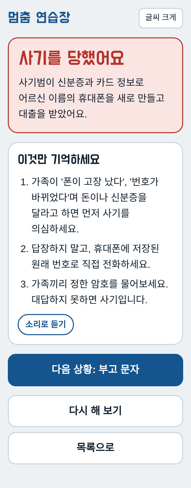
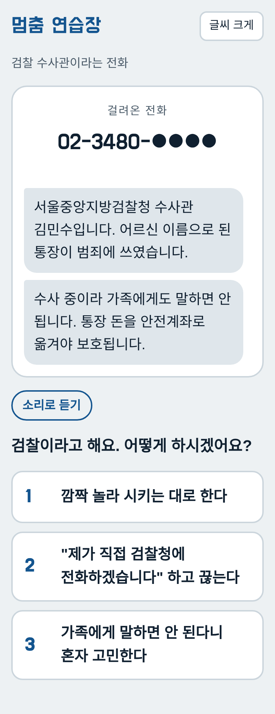

# 멈춤 연습장

> 어르신이 사기 문자와 전화를 **미리 겪어 보고** 대응을 연습하는 모바일 웹앱

**▶ 바로 써 보기:** https://<깃허브-아이디>.github.io/mumchum/ (설치 없이 휴대폰 브라우저에서 열림)

가천대학교 아르테크네센터 2026 프로젝트 「정해진 답은 없다」 참가작입니다.
키워드: **대상** 노인 · **물건** 스마트폰 · **형식** 앱 · **목적** 안전

  
  
  

## 왜 만들었나

어르신은 자녀 사칭 문자, 부고·택배 링크, 검찰 사칭 전화 같은 사기에 자주 노출되지만, 막상 그 순간에 어떻게 해야 하는지는 미리 연습할 기회가 없습니다.

- 2025년 보이스피싱 피해액은 **1조 2,578억 원**으로 최근 5년 중 최대이고, 그중 **78.6%가 기관사칭형**입니다. ([경찰청 자료 보도](https://www.inews24.com/view/2008688))
- 2025년 상반기 스미싱 문자 약 3만 7천 건 중 금융기관 사칭 19%, 청첩·부고 등 지인 사칭 12%였습니다. ([카카오뱅크 분석 보도](https://biz.sbs.co.kr/amp/article/20000245520))

설명을 읽는 교육보다 **직접 골라 보고 결과를 겪어 보는 연습**이 실제 상황에서 행동으로 이어진다고 보고, 선택형 시뮬레이터로 만들었습니다.

## 어떻게 쓰나

1. 진짜 같은 사기 문자·전화 화면이 나옵니다.
2. 어떻게 할지 큰 버튼으로 고릅니다.
3. 고른 대로 이야기가 이어지고 **안전 / 아슬아슬 / 피해** 중 하나로 끝납니다.
4. 끝마다 "이것만 기억하세요" 3줄로 올바른 대처법을 알려 줍니다.

모든 상황에 공통인 원칙은 세 단어입니다: **멈춤**(바로 하지 않기) → **끊기** → **확인**(원래 번호로 전화)

## 기능

| 기능 | 내용 |
| --- | --- |
| 사기 상황 5개 | 자녀 사칭 문자 · 부고 링크 문자 · 택배 문자 · 검찰 사칭 전화 · 카드 발급 문자 ([분기 지도](docs/scenario-map.md)) |
| 어르신용 화면 | 기본 20px 글씨, "글씨 크게" 24px, 버튼 높이 64px 이상, 한 화면에 질문 하나 |
| 소리로 듣기 | 문자 내용과 선택지를 음성으로 읽어 줌 (브라우저 음성 합성) |
| 가족 암호 카드 | 가족만 아는 질문을 정해 큰 카드로 보여 줌 |
| 사전·사후 문제 | 같은 5문항을 연습 전후에 풀어 정답률 변화 측정 |
| 기록 보기 | 참여자별 점수 변화, 결말 통계, CSV 복사 |

  
  
  

## 기술

- HTML · CSS · JavaScript 한 파일 (`index.html`), 서버·설치 없음
- 기록은 브라우저 `localStorage`에만 저장 (개인정보를 서버로 보내지 않음)
- Web Speech API로 음성 읽기, 다크 모드 지원
- 시나리오는 노드 그래프 데이터로 작성 → 새 사기 유형을 데이터만 추가해 확장
- 개발 과정에서 생성형 AI(Claude)를 활용했습니다

## 진행 과정

| 문서 | 내용 |
| --- | --- |
| [조사와 인터뷰](docs/01-research.md) | 사기 통계, 할머니 인터뷰, 유형 선정 이유 |
| [설계](docs/02-design.md) | 분기 구조, 어르신 사용성 기준, 사전·사후 문제 설계 |
| [시나리오 분기 지도](docs/scenario-map.md) | 5개 시나리오의 선택 흐름 (선택 화면 11개, 결말 17개) |
| [테스트](docs/03-testing.md) | 어르신 사전·사후 테스트 방법과 결과 |
| [개발 일지](docs/devlog.md) | 날짜별 진행 기록 |

## 다음 계획

- [ ] AI 허위 영상 구별 시나리오 추가 (건강식품·약 광고, 가짜 뉴스 영상) — 할머니 인터뷰에서 나온 요구
- [ ] 어르신 3명 이상 사전·사후 테스트, 정답률 비교
- [ ] 테스트 피드백 반영
- [ ] 3분 시연 영상

## 실행하기

`index.html`을 브라우저로 열면 바로 동작합니다. 공개 주소는 GitHub Pages(Settings → Pages → `main` / root)로 배포합니다.

---

만든 사람: 하승준 · 가천대학교 AI/소프트웨어학과
