# 멈춤 연습장

> 어르신이 사기 문자·전화·AI 허위 영상을 **미리 겪어 보고** 대응을 연습하는 모바일 웹앱

**▶ 바로 써 보기:** https://haseungjune0614-create.github.io/mumchum/ (설치 없이 휴대폰 브라우저에서 열림)

가천대학교 아르테크네센터 2026 프로젝트 「정해진 답은 없다」 참가작입니다.
키워드: **대상** 노인 · **물건** 스마트폰 · **형식** 앱 · **목적** 안전

  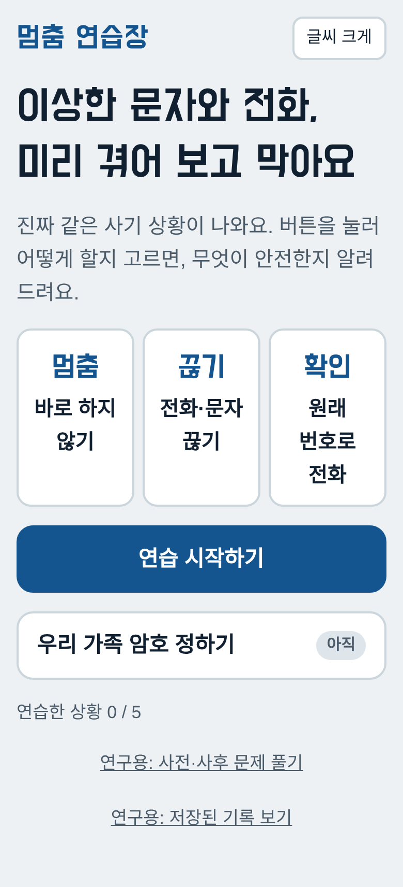
  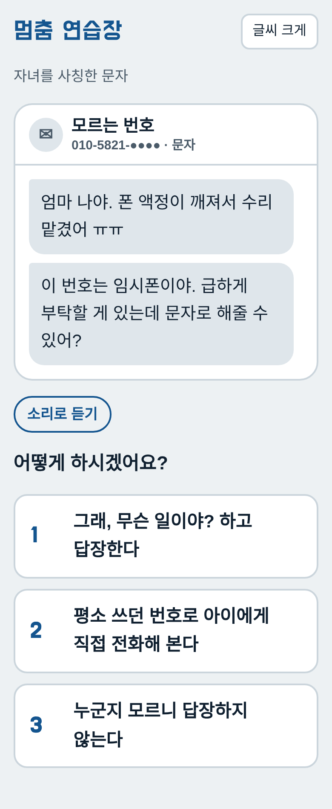
  

## 어르신 테스트 결과 한눈에

2026년 11월 21~22일 경로당 어르신 3분이 사전 문제 → 연습 7개 → 사후 문제를 끝까지 마치셨습니다 ([자세한 결과](docs/03-testing.md)).

- 평균 정답 **4.0 → 4.3** (6문제 중, 67% → 72%). 점수가 떨어진 분은 없었고, 3명의 시범 테스트라 효과를 일반화하지는 않습니다.
- **발견:** 어르신들은 "확인해야 한다"는 건 알고 계셨지만, 확인하는 통로를 **사기범이 준 번호와 문자**로 고르셨습니다. ("이 번호로 전화해서 목소리를 들어 본다", "문자 속 고객센터 번호로 전화한다")
- **개선 (11/23):** 연습에 이 함정이 없었던 것이 원인이어서, 어르신이 실제로 고른 오답을 선택지로 넣고 고르면 이유를 알려 주는 결말을 추가했습니다. AI로 가족 목소리를 흉내 내는 장면도 넣었습니다.

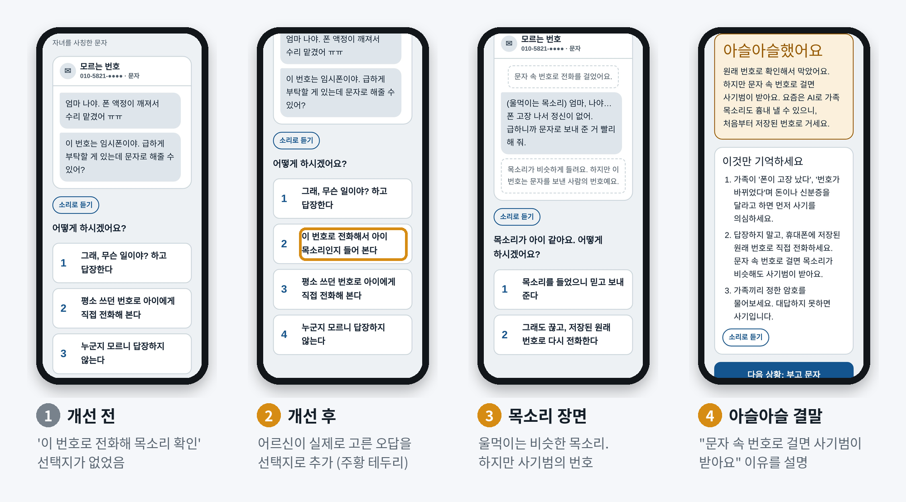

## 왜 만들었나

어르신은 자녀 사칭 문자, 부고·택배 링크, 검찰 사칭 전화, AI로 만든 가짜 의사·가짜 뉴스 영상 같은 사기에 자주 노출되지만, 막상 그 순간에 어떻게 해야 하는지는 미리 연습할 기회가 없습니다.

- 2025년 보이스피싱 피해액은 **1조 2,578억 원**으로 최근 5년 중 최대이고, 그중 **78.6%가 기관사칭형**입니다. ([경찰청 자료 보도](https://www.inews24.com/view/2008688))
- 2026년 4월 유튜브 '노인 건강' 조회수 상위 100개 영상 중 **42개가 생성형 AI로 제작**됐고, **24개는 의사 등 전문가를 사칭**했습니다. ([한국건강증진개발원 자료 보도](https://biz.sbs.co.kr/amp/article/20000340952))
- 2025년 상반기 스미싱 문자 약 3만 7천 건 중 금융기관 사칭 19%, 청첩·부고 등 지인 사칭 12%였습니다. ([카카오뱅크 분석 보도](https://biz.sbs.co.kr/amp/article/20000245520))

설명을 읽는 교육보다 **직접 골라 보고 결과를 겪어 보는 연습**이 실제 상황에서 행동으로 이어진다고 보고, 선택형 시뮬레이터로 만들었습니다.

## 어떻게 쓰나

1. 진짜 같은 사기 문자·전화 화면이 나옵니다.
2. 어떻게 할지 큰 버튼으로 고릅니다.
3. 고른 대로 이야기가 이어지고 **안전 / 아슬아슬 / 피해** 중 하나로 끝납니다.
4. 끝마다 "이것만 기억하세요" 3줄로 올바른 대처법을 알려 줍니다.
5. AI 영상 상황은 끝난 뒤 **영상을 다시 보며 수상한 곳을 직접 눌러 찾는** 단계가 이어집니다.

모든 상황에 공통인 원칙은 세 단어입니다: **멈춤**(바로 하지 않기) → **끊기** → **확인**(원래 번호로 전화)

## 기능

| 기능 | 내용 |
| --- | --- |
| 사기 상황 7개 | 자녀 사칭 문자 · 부고 링크 문자 · 택배 문자 · 검찰 사칭 전화 · 카드 발급 문자 · **AI 가짜 의사 광고 · 가짜 뉴스 영상** ([분기 지도](docs/scenario-map.md)) |
| **수상한 점 찾기** | AI 영상 화면에서 6개·5개 단서(손가락 6개, 이름 없는 '전문의', 마감 압박, 가짜 주소, 똑같은 칭찬 댓글 등)를 손가락으로 눌러 찾기. 함정 영역은 "여기는 단서가 아니에요" 안내, 못 찾은 단서는 이유와 함께 표시 |
| **가족 맞춤 연습** | 자녀가 호칭·이름을 넣어 링크를 보내면 부모님 휴대폰의 자녀 사칭 문자가 "아빠 나야, 민수"처럼 우리 가족 이름으로 나옴 (이름은 링크 안에만, 서버 전송 없음) |
| 어르신용 화면 | 기본 20px 글씨, "글씨 크게" 24px, 버튼 높이 64px 이상, 한 화면에 질문 하나 |
| 소리로 듣기 | 문자 내용과 선택지를 음성으로 읽어 줌 (브라우저 음성 합성) |
| 가족 암호 카드 | 가족만 아는 질문을 정해 큰 카드로 보여 줌 |
| **연습 효과 테스트** | 처음 화면에서 누구나 참여: 사전 6문항 → 연습 7개 → 사후 6문항. 끝나면 결과가 구글 시트로 자동 전달되고, 선생님은 시트로 결과만 확인 ([만드는 법](docs/sheet-setup.md)) |
| 진행자 모드 | 주소 끝에 `?staff`를 붙여 열면 연구용 메뉴(직접 진행하는 사전·사후 문제, 기록 보기·CSV 복사)가 나타남 |

  
  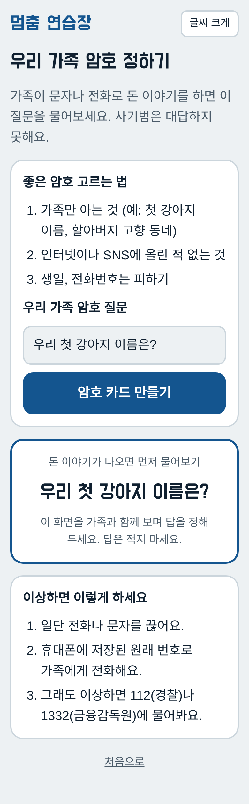
  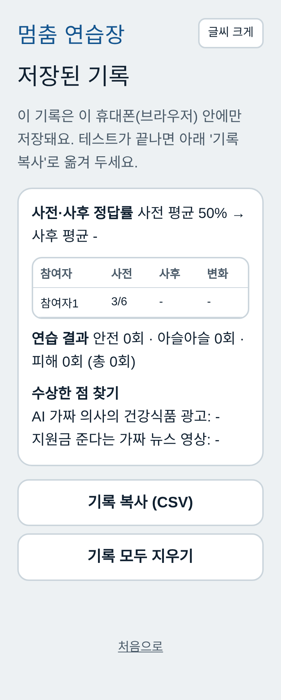

  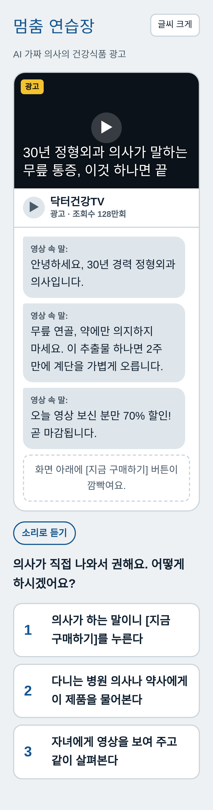
  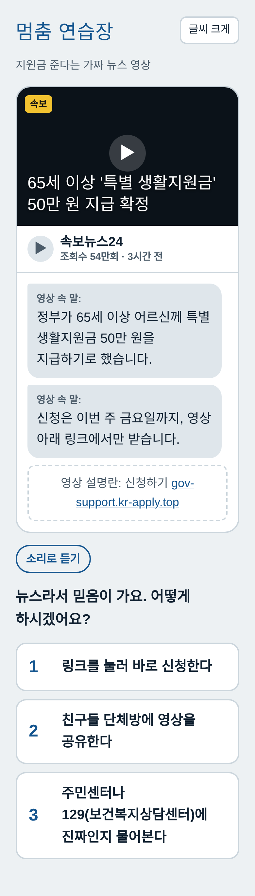
  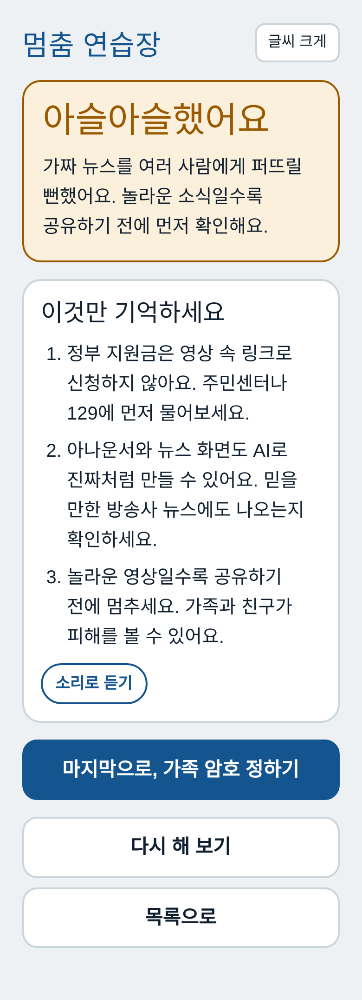

  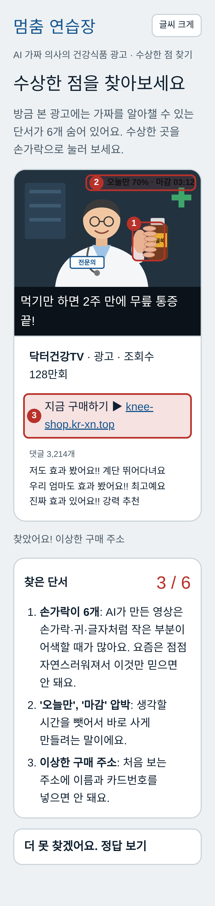
  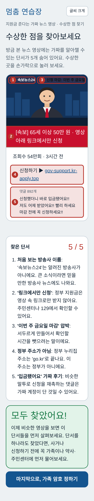
  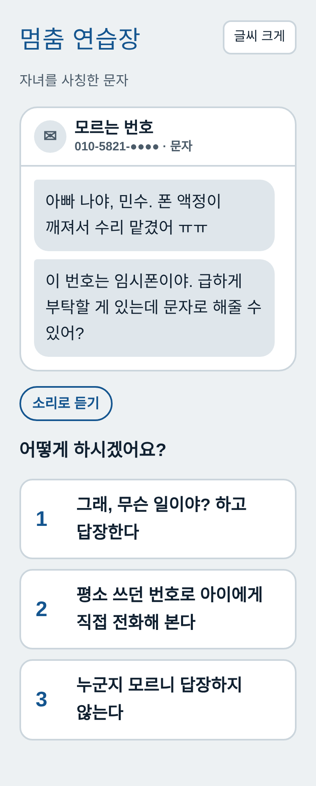

## 기술

- HTML · CSS · JavaScript 한 파일 (`index.html`), 설치 없음
- 연습 기록은 휴대폰 브라우저 `localStorage`에만 저장
- 테스트 결과만 구글 시트(Apps Script, [`scripts/sheet.gs`](scripts/sheet.gs))로 전송. 자동으로 만든 참여자 번호와 점수·고른 답만 보내고 **이름·전화번호는 받지 않음** (사기 예방 앱이 개인정보 입력을 요구하면 교육 내용과 모순되기 때문)
- Web Speech API로 음성 읽기, 다크 모드 지원
- 시나리오는 노드 그래프 데이터로 작성 → 새 사기 유형을 데이터만 추가해 확장
- `node scripts/make-map.js`로 분기 지도 문서를 자동 생성하고, 끊긴 선택지·도달할 수 없는 화면을 검사
- 개발 과정에서 생성형 AI(Claude)를 활용했습니다

## 진행 과정

| 문서 | 내용 |
| --- | --- |
| [조사와 인터뷰](docs/01-research.md) | 사기 통계, 할머니 인터뷰, 유형 선정 이유 |
| [설계](docs/02-design.md) | 분기 구조, 어르신 사용성 기준, 사전·사후 문제 설계 |
| [시나리오 분기 지도](docs/scenario-map.md) | 7개 시나리오의 선택 흐름 (선택 화면 17개, 결말 27개) |
| [테스트](docs/03-testing.md) | 어르신 사전·사후 테스트 방법과 결과 |
| [개발 일지](docs/devlog.md) | 날짜별 진행 기록 |

## 다음 계획

- [x] AI 허위 영상 구별 시나리오 추가 (건강식품·약 광고, 가짜 뉴스 영상) — 할머니 인터뷰에서 나온 요구
- [x] 어르신 3명 사전·사후 테스트, 정답률 비교 (결과는 구글 시트로 자동 수집)
- [x] 테스트에서 발견한 오답 패턴을 연습에 반영
- [x] 3분 시연 영상, 최종 결과보고서
- [ ] 개선한 버전으로 다시 테스트해 ①·⑤ 문항이 달라지는지 확인
- [ ] 사후 문제를 같은 유형의 다른 상황으로 바꿔, 문제를 외운 효과와 연습 효과 구분
- [ ] 연습을 나눠 하는 짧은 테스트로 참여 부담 줄이기

## 실행하기

`index.html`을 브라우저로 열면 바로 동작합니다. 공개 주소는 GitHub Pages(Settings → Pages → `main` / root)로 배포합니다.

---

만든 사람: 하승준 · 가천대학교 AI/소프트웨어학과
