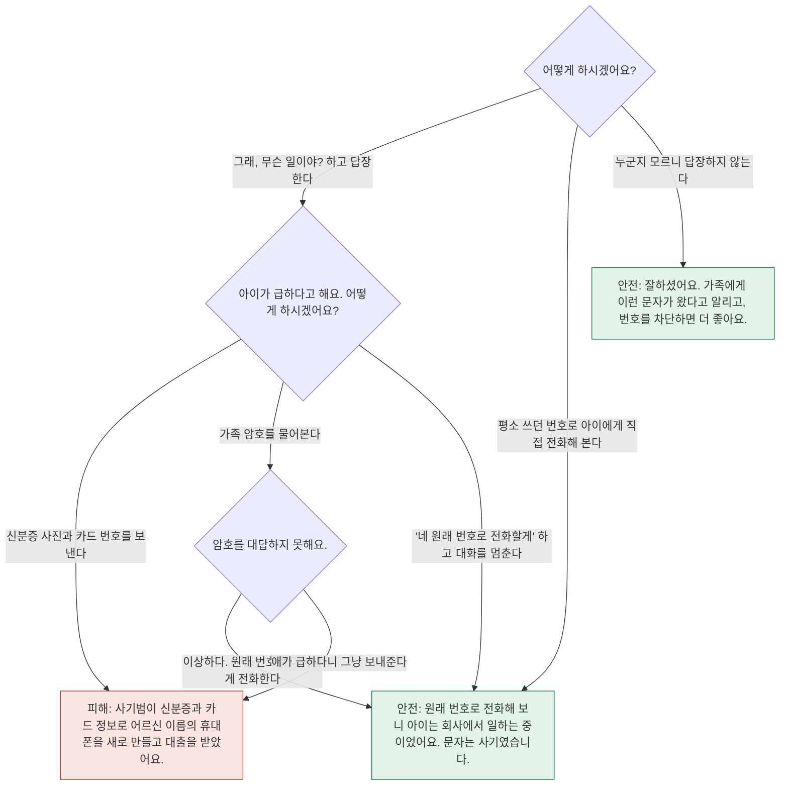
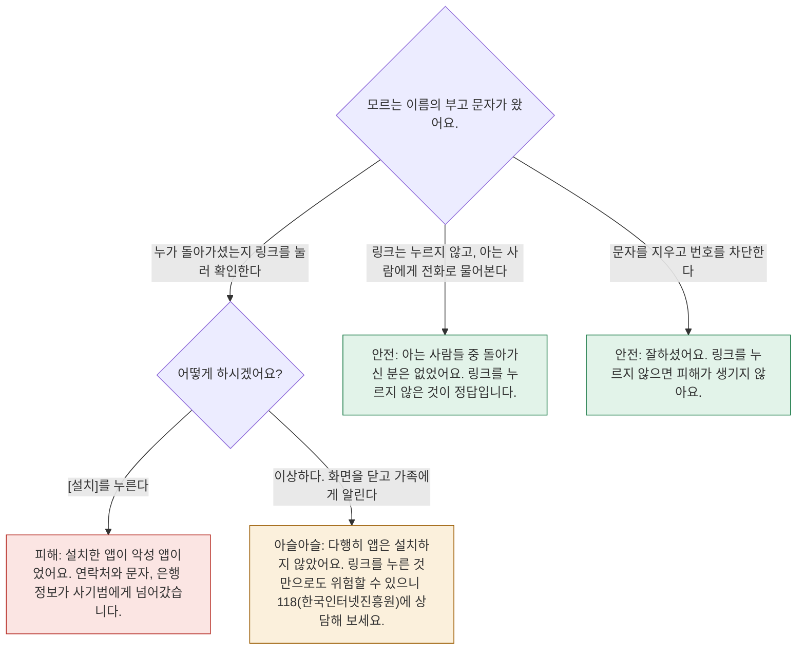
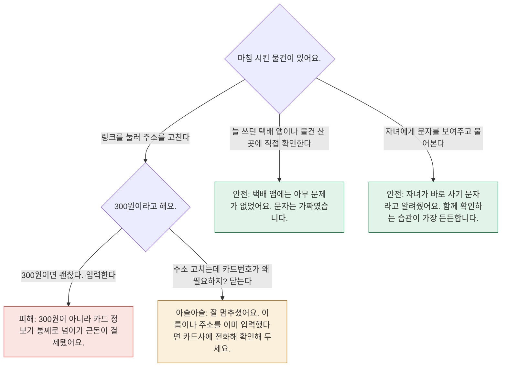
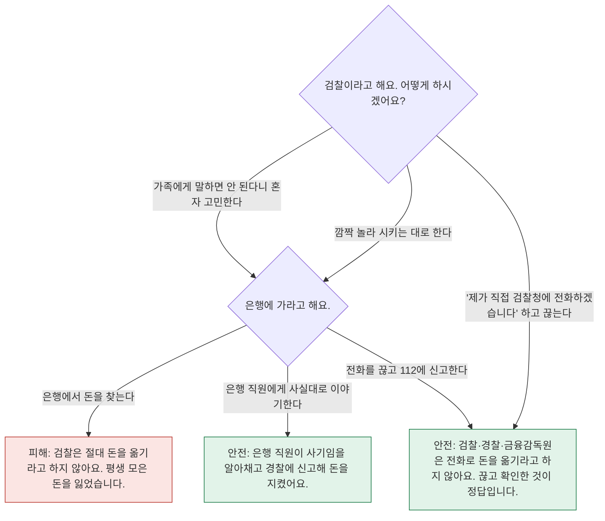
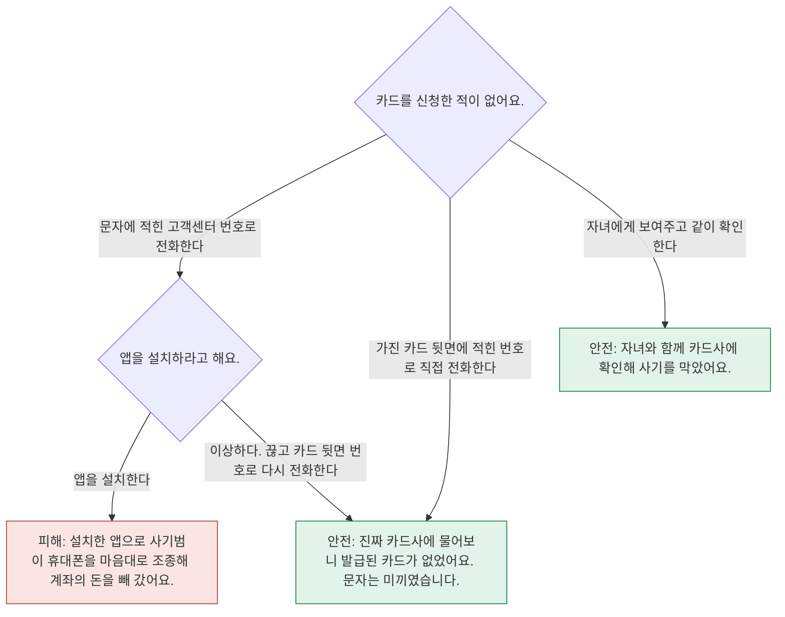

# 시나리오 분기 지도

5개 시나리오의 선택 흐름입니다. 초록은 안전, 노랑은 아슬아슬, 빨강은 피해 결말입니다. `index.html`의 시나리오 데이터에서 자동으로 만들었습니다.
선택 화면 11개, 결말 17개.

## 1. 자녀를 사칭한 문자

**이것만 기억하세요**

1. 가족이 '폰이 고장 났다', '번호가 바뀌었다'며 돈이나 신분증을 달라고 하면 먼저 사기를 의심하세요.
2. 답장하지 말고, 휴대폰에 저장된 원래 번호로 직접 전화하세요.
3. 가족끼리 정한 암호를 물어보세요. 대답하지 못하면 사기입니다.

## 2. 부고 문자

**이것만 기억하세요**

1. 부고·청첩장 문자 속 인터넷 주소(링크)는 누르지 마세요.
2. 진짜 부고라면 아는 사람에게 전화로 확인할 수 있어요.
3. '앱을 설치하라'는 화면이 나오면 절대 누르지 마세요.

## 3. 택배 주소 확인 문자

**이것만 기억하세요**

1. '[국제발신]'으로 오는 택배 문자는 대부분 사기입니다.
2. 택배 확인은 문자 링크가 아니라 늘 쓰던 앱이나 산 곳에서 하세요.
3. 적은 돈이라도 카드번호와 비밀번호를 달라고 하면 사기입니다.

## 4. 검찰 수사관이라는 전화

**이것만 기억하세요**

1. 검찰·경찰·금융감독원은 전화로 돈을 옮기라고 절대 하지 않습니다.
2. '아무에게도 말하지 마라'는 말이 나오면 사기입니다.
3. 일단 끊고, 112나 가족에게 바로 알리세요.

## 5. 카드 발급 완료 문자

**이것만 기억하세요**

1. 모르는 카드 발급 문자는 미끼입니다. 문자 속 번호로 전화하지 마세요.
2. 카드사나 은행 확인은 카드 뒷면이나 통장에 적힌 번호로 직접 하세요.
3. 전화로 앱을 설치하라고 하면 사기입니다.
